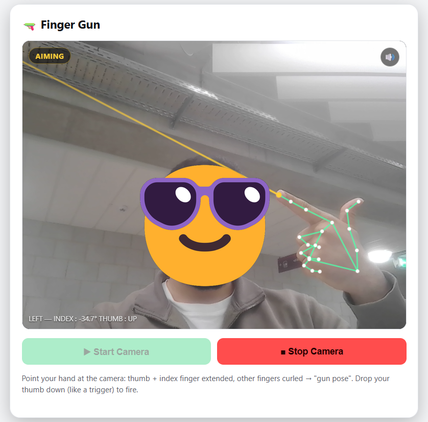
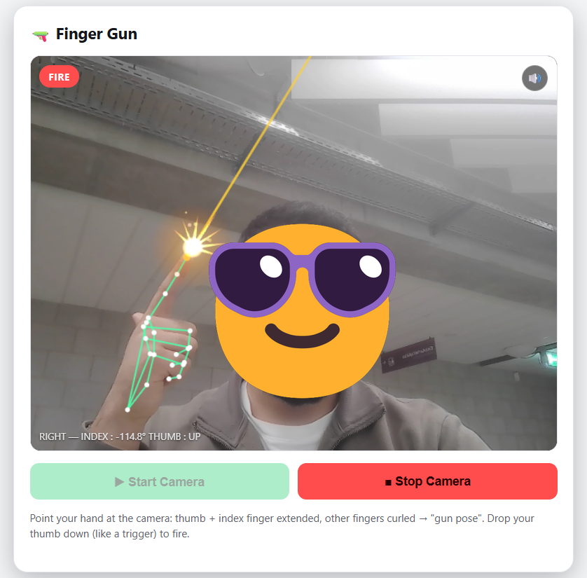

# Finger Gun

Can a webcam recognise a "finger gun" and fire when you pull the trigger with your thumb? This browser app tracks your hands in real time with MediaPipe Hands, detects the gun pose from the hand landmarks and fires a shot with a muzzle flash and sound when you drop your thumb.

**Live demo:** https://mehdigurbanzade.github.io/finger-gun/

<p align="center">
  
  
</p>

## Highlights

- **Real-time hand tracking in the browser**: MediaPipe Hands detects 21 landmarks per hand for up to two hands, each tracked separately (left and right)
- **Rule-based gesture recognition** on the landmarks:
  - a finger counts as extended if its tip is farther from the wrist than its base joint, or if the middle finger joint is almost straight (angle above 140°), which keeps the check stable when the hand is rotated
  - **gun pose** = index finger extended, middle, ring and little finger curled
  - **thumb up** = distance from thumb tip to the base of the little finger, relative to hand size, above 0.45
- **Trigger logic**: a shot fires when the thumb goes from up to down while the gun pose is held, with a short cooldown to avoid double shots
- **Visual feedback**: hand skeleton overlay, a laser along the index finger, an animated muzzle flash drawn on the canvas, and a status label (`NO HAND`, `NO POSE`, `AIMING`, `FIRE`)
- **Sound**: an embedded gunshot sample, with a mute button
- **Privacy**: the video is processed locally in the browser and is never uploaded

## How to use

1. Open the [live demo](https://mehdigurbanzade.github.io/finger-gun/) and click **Start Camera** (allow camera access).
2. Make a finger gun: index finger and thumb extended, the other fingers curled. The label switches to **AIMING** and a laser appears.
3. Drop your thumb like a trigger to **FIRE**.

## Project structure

| File | Description |
|---|---|
| `index.html` | The complete app: layout, styles, hand tracking, gesture logic, drawing and sound |
| `images/` | Screenshots used in this README |

## How to run locally

The camera only works on a secure origin, so serve the folder through a local web server instead of opening the file directly:

```bash
python -m http.server 8000
```

Then open `http://localhost:8000`. An internet connection is required, because the MediaPipe model files are loaded from a CDN.

## Limitations and next steps

- The thresholds (joint angle, thumb distance) are fixed and were tuned by hand; very small or partly hidden hands, strong backlight or fast movements can cause missed or false detections.
- The gesture logic is rule-based. Training a small classifier on the landmarks would make it more robust and could add more gestures.
- The file still contains unused code for a synthesised gunshot (noise burst and reverb); only the embedded sample is played.
- Ideas: targets to shoot at with a score, a reload gesture, and moving to the newer MediaPipe Tasks API.

**Author:** Mehdi Gurbanzade · M.Sc. Data Science
